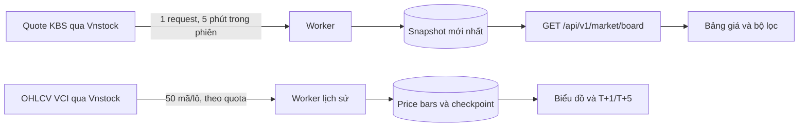

# Kiến trúc dữ liệu thị trường

- Bảng giá có đủ danh mục trong một phản hồi. Giao diện chỉ vẽ 100 dòng đầu, còn tìm kiếm, lọc và sắp xếp trên toàn bộ danh mục đã nhận. Trang tự lấy snapshot mới mỗi 5 phút khi đang mở và khi quay lại tab, không xoá bảng đang xem. Request xem trang không chạm nhà cung cấp.
- Quote KBS là ảnh chụp có thể trễ. `snapshotAt` chỉ là thời điểm lấy về; mã không có giá khớp giữ `null`, còn giá tham chiếu ở cột riêng. Một lần làm mới thất bại không thay snapshot cũ, nên thời điểm cũ vẫn hiện ra.
- Lịch sử VCI phục vụ biểu đồ và nghiên cứu tin so với giá. Job chạy lô nhỏ có checkpoint và tôn trọng hạn mức Vnstock; chỉ số được lấy khi khởi tạo và trong job EOD, không lặp ở từng lô. Lỗi giữa lô không tạo checkpoint giả. Tốc độ lịch sử không chặn bảng giá.
- Bảng giá chưa có khối lượng giao dịch và định giá từ cùng nguồn. Các cột không có dữ liệu được ẩn. Dashboard và trang mã vẫn dùng daily bars; đồng nhất chúng với snapshot trong phiên là công việc tiếp theo.
